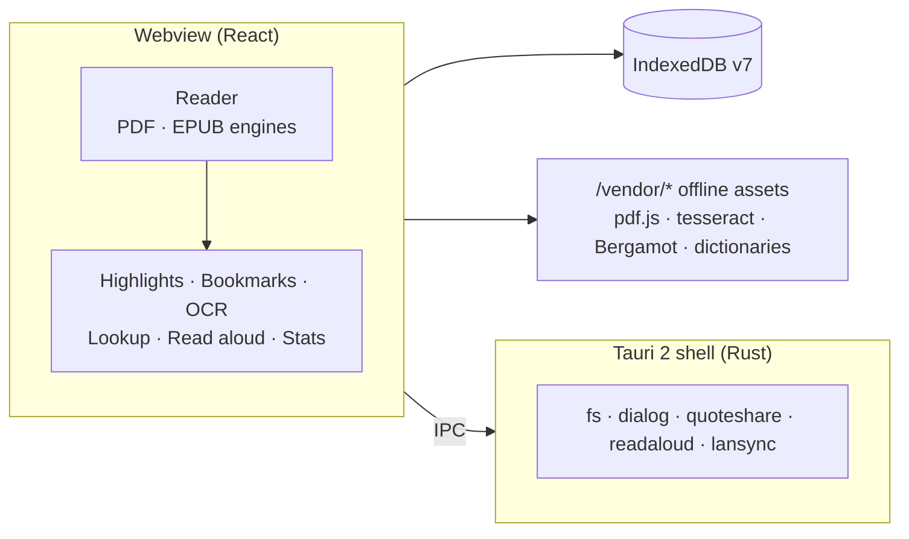

<div align="center">


**A private, offline reading library for macOS and Android.**<br />
Read EPUB and PDF, highlight, take notes, look words up, translate, listen, and track your reading, all on your device.


[Features](#features) · [Getting started](#getting-started) · [Development](#development) · [Release](#release) · [Architecture](#architecture) · [Credits](#credits)

</div>

---

## Why LumaRead

- **Private by design.** Books, highlights, notes, OCR results and reading stats live in the app's own storage. There are no accounts, no servers and no analytics. The only thing that ever leaves a device is Wi-Fi sync, and only to your own paired devices, encrypted.
- **Fully offline.** PDF rendering, OCR, dictionaries, translation and read-aloud all run on the device.
- **One codebase.** One Tauri 2 + React + TypeScript project ships a macOS `.dmg` and an Android `.apk`.

> [!IMPORTANT]
> Your library is stored inside the app. Uninstalling the app deletes it. Export your highlights and notes (Markdown / CSV) as a backup.

## Features

### Library
| | |
| :-- | :-- |
| 📥 **Import** | EPUB and PDF, plus CBZ comics, TXT and Markdown (converted to EPUB on import, so highlights, search, read aloud and sync work on them too). Format is checked from file contents, duplicates are caught by SHA-256, files up to 200 MB, cover thumbnails |
| 🏷️ **Details** | Titles and authors from metadata or from `Title - Author` file names, editable afterwards |
| 🏠 **Home & Library** | Continue reading, recent files; format tabs (EPUB, PDF, Comics, Text), filter by shelf and status, sort by recent, added, title, author or progress |
| 🗂️ **Shelves** | Put books on your own shelves from a book's menu; rename or delete shelves under Manage shelves |

### Reading
| | |
| :-- | :-- |
| 📄 **PDF** | pdf.js viewer with zoom presets and selectable text. JBIG2 / JPEG 2000 scans, CJK and non-embedded fonts render offline |
| 📖 **EPUB** | Chapters, font size, line spacing, Source Serif 4. The book's own scripts are always blocked |
| 🧘 **Focus mode** | Header and footer float away so the page fills the screen. Tap the page (or hover an edge on desktop) to bring them back |
| 🎨 **Page colour** | Light, Sepia or Dark for both EPUB and PDF. Sepia tints the PDF page itself, not just the margins |
| ↔️ **Layouts** | Desktop: Scroll or Side by side (book spreads, cover alone). Phone: Scroll or Swipe, one page per swipe |
| 🔖 **Bookmarks** | Name a place, jump back from the reader or the Bookmarks page, rename or delete. A ribbon marks bookmarked pages |
| 🔍 **Find in book** | ⌘F / Ctrl+F or the search button: every match in the open book, ignoring case and accents, highlighted page by page |
| 🎧 **Read aloud** | Uses the device's installed voices, follows along highlighting the sentence, 0.75×–2× speed, sleep timer (15 / 30 / 60 min or end of chapter). Scanned pages are run through OCR just before they're read |
| 📍 **Progress** | Saved as a versioned anchor and restored on reopen. Jumping in from a highlight, note, bookmark or search hit doesn't overwrite your last-read page |

### Notes & knowledge
| | |
| :-- | :-- |
| 🖍️ **Highlights & notes** | 4 colours, notes on highlights or whole documents, copy a quote with its source |
| 📤 **Export** | Markdown or CSV through the system save dialog. CSV is formula-safe with a UTF-8 BOM |
| 🔎 **Search** | Titles, book text, highlights and notes, ignoring case and accents. Results open the right page or chapter (⌘K / Ctrl+K) |
| 🔤 **OCR** | tesseract.js (Indonesian + English) for scanned PDFs. The page being read is recognised automatically; recognised words are selectable, highlightable and searchable |
| 📚 **Dictionary** | Open English WordNet and Indonesian Wiktionary, with Indonesian root finding (`menatap` → `tatap`) |
| 🌐 **Translation** | Indonesian ⇄ English with Mozilla's Bergamot models, entirely on the device |

### Habits & sharing
| | |
| :-- | :-- |
| ⏱️ **Reading timer** | Total time on the book. Pauses itself when the window is hidden or after 2 minutes without input; tap to pause or resume |
| 📊 **Reading stats** | Active time, pages, streaks, pace and time left, for 7 / 30 / 90 days, all books or one, as charts or tables |
| 🏆 **Achievement cards** | Story or square image with a bar or line chart (days on the x axis, minutes on the y axis) |
| 💬 **Quote cards** | Any highlight as a 1080×1920 story or 1080×1080 square (Luma / Paper / Night). Android opens the system share sheet; desktop saves or copies the image |
| 🔄 **Wi-Fi sync** | Pair your Mac and phone once (both screens show the same 6-digit code), then **Sync now** copies books both ways and merges progress, highlights, notes, bookmarks and reading stats. Newest change wins, deletions carry over, and a book removed from one device is never deleted elsewhere. No internet or account involved |
| 🛡️ **Safe deletes** | Removing a book, resetting progress or deleting a highlight, note or bookmark always asks first |
| 🌗 **App theme** | Light (default), Dark, or follow the system |

## Getting started

### Prerequisites

| Tool | For |
| :-- | :-- |
| [Node.js](https://nodejs.org) + [pnpm](https://pnpm.io) | web build, tests |
| [Rust](https://rustup.rs) + [Tauri 2 prerequisites](https://tauri.app/start/prerequisites/) | desktop app |
| Android SDK + NDK | Android app only |
| `unzip` | building the dictionaries |

### Install

```sh
git clone https://github.com/adityatriand/lumaread.git
cd lumaread
pnpm install
pnpm setup:data   # once: builds data/dictionaries (~16 MB), downloads and verifies data/translation (~41 MB)
pnpm tauri dev    # desktop dev window
```

> [!NOTE]
> `data/` is generated, not committed (only `data/dictionaries/ATTRIBUTION.md` is tracked). If it's missing, the build stops and tells you to run `pnpm setup:data`.

## Development

| Command | What it does |
| :-- | :-- |
| `pnpm tauri dev` | Desktop dev window (Vite on port 1420) |
| `pnpm build` | Type-check + web build |
| `pnpm test` | Unit tests (Vitest) |
| `pnpm test:e2e` | Playwright in Chrome (stands in for the Android WebView) and WebKit (for the macOS app), against `vite preview` with the app's CSP |
| `pnpm tauri android dev` | Android dev build |

```sh
# Android
export ANDROID_HOME=$HOME/Library/Android/sdk
export NDK_HOME=$ANDROID_HOME/ndk/29.0.14206865
pnpm tauri android build --apk --debug --target aarch64
```

E2E tests stub `globalThis.isTauri` and Tauri's IPC to drive the UI in a browser. In a plain browser the app shows only an "open the app" screen (`src/main.tsx`).

<details>
<summary><b>Platform gotchas worth knowing</b></summary>

- **WebKit streams:** the macOS webview can't `for await` a `ReadableStream`, which pdf.js uses for text extraction. `src/lib/pdf.ts` polyfills it; without it, search indexing and scanned-PDF detection (and so OCR) silently fail in the app.
- **`%PDF` in scripts:** Tauri picks MIME types by sniffing content, so a script with `%PDF` in its first 1 KB would be served as `application/pdf`. The Vite build refuses such a chunk.
- **Read aloud:** macOS uses the webview's `speechSynthesis`. The Android WebView has none, so `src-tauri/plugins/readaloud` drives Android's TextToSpeech. Indonesian may need an offline voice installed in Android Settings → Text-to-speech.
- **Wi-Fi sync:** devices find each other by UDP broadcast on port 47321 and talk over TCP while the Sync page is open. Pairing is ECDH (P-256) confirmed by a 6-digit code on both screens; messages are AES-256-GCM encrypted in the web app, so the native side only relays ciphertext. macOS 15+ asks once for Local Network access (`src-tauri/Info.plist`); Android holds a multicast lock only while syncing.
- **EPUB in WebKit:** `allowScriptedContent` is needed for selection, links and keys to work in the macOS app; book scripts stay blocked by an injected CSP.

</details>

## Release

```sh
pnpm tauri build --target aarch64-apple-darwin --bundles dmg   # Apple Silicon
pnpm tauri build --target x86_64-apple-darwin --bundles dmg    # Intel Macs (rustup target add x86_64-apple-darwin)
pnpm tauri android build --apk --target aarch64                 # signed APK for 64-bit ARM phones (nearly all in use)
```

| Platform | Signing |
| :-- | :-- |
| **macOS** | Ad-hoc signed (`signingIdentity: "-"`), macOS 13.3+. Without a Developer ID, the first launch shows "unidentified developer": right-click the app → Open once. Notarized builds need an Apple Developer account |
| **Android** | Release key in `~/.lumaread-release/` (`lumaread-release.jks` + `keystore.properties`), read by `src-tauri/gen/android/app/build.gradle.kts`. Set `LUMAREAD_KEYSTORE_PROPERTIES` for another location (CI). Nothing secret is in the repo |

> [!WARNING]
> Back up `~/.lumaread-release/`. Without that key, no update can ever be signed for installed Android apps.

- **Version** lives in `package.json`, `src-tauri/tauri.conf.json` and `src-tauri/Cargo.toml`; Android's versionCode is derived from it.
- **Size:** Tauri compresses the web assets (~46 MB, mostly translation models) into the native binary, so each CPU architecture in a package carries its own copy. A universal APK (4 ABIs) is ~187 MB; one architecture per package is ~50 MB. Add `--target armv7` for old 32-bit phones; x86 / x86_64 are only emulators.

## Architecture



Reader engines take and emit LumaRead's own anchors (`src/lib/anchor.ts`), never pdf.js / epub.js locations. That keeps stored progress, highlights and bookmarks independent of library internals.

<details>
<summary><b>Project layout</b></summary>

```
src/lib/                       db.ts (IndexedDB v7), anchor.ts, hash.ts, pdf.ts, rects.ts, saveFile.ts, zip.ts
src/components/                AppShell, Select, ConfirmDialog, useOutsideClose
src/features/library/          import (+ CBZ/TXT/MD → EPUB in convert.ts), Home, Library, shelves
src/features/reader/           ReaderView, PdfReader, EpubReader, ReaderChrome, BookmarkMenu, FindBar
src/features/bookmarks/        Bookmarks page
src/features/sync/             merge rules, wire format + crypto, pairing & sync protocol, Sync page
src/features/readaloud/        speech (voices + sentence chunks), playback hook, player bar
src/features/notebook/         Highlights & Notes, editor, Markdown/CSV export
src/features/search/           text indexing (+ scanned-PDF detection), search
src/features/ocr/              tesseract worker, OCR queue, selectable OCR text layer
src/features/lookup/           dictionary, stemmers, Bergamot translation client
src/features/stats/            reading sessions, timer, charts, Stats page, achievement card
src/features/share/            card canvas, quote card, share dialog
src/features/settings/         reading prefs, privacy, licences
scripts/                       build-dictionaries.mjs, fetch-translation-models.mjs
vite.config.ts                 vendor-assets plugin: serves offline runtime files at /vendor/*
src-tauri/                     Rust shell, CSP, capabilities, Android project in gen/android
src-tauri/plugins/quoteshare/  Android share sheet via FileProvider (no storage permission)
src-tauri/plugins/readaloud/   Android TextToSpeech for read aloud
src-tauri/plugins/lansync/     Wi-Fi sync transport: UDP discovery + TCP relay of encrypted messages
```

Size added by offline features: pdf.js assets 3.5 MB, OCR 7.8 MB, dictionaries ~16 MB (JSON, compresses well), translation ~46 MB.

</details>

## Credits

LumaRead stands on these open projects (also listed in the app under Settings → About & licences):

| Component | By | Licence |
| :-- | :-- | :-- |
| PDF rendering | PDF.js — Mozilla | Apache-2.0 |
| EPUB rendering | epub.js — FuturePress | BSD-2-Clause |
| Text recognition (OCR) | Tesseract & tesseract.js, Indonesian and English data | Apache-2.0 |
| Offline translation | Bergamot translator & Firefox Translations models — Mozilla | MPL-2.0 |
| English dictionary | Open English WordNet 2025 contributors | CC BY 4.0 |
| Indonesian dictionary | Wiktionary contributors, via kaikki.org (first three senses) | CC BY-SA 4.0 |
| Reading typeface | Source Serif 4 — Adobe | SIL OFL 1.1 |
| Icons | Lucide | ISC |

## License

No license has been chosen yet, so all rights are reserved until a `LICENSE` file is added. The third-party components above keep their own licences.

<div align="center">
<sub>© 2026 Aditya Tri Ananda</sub>
</div>
